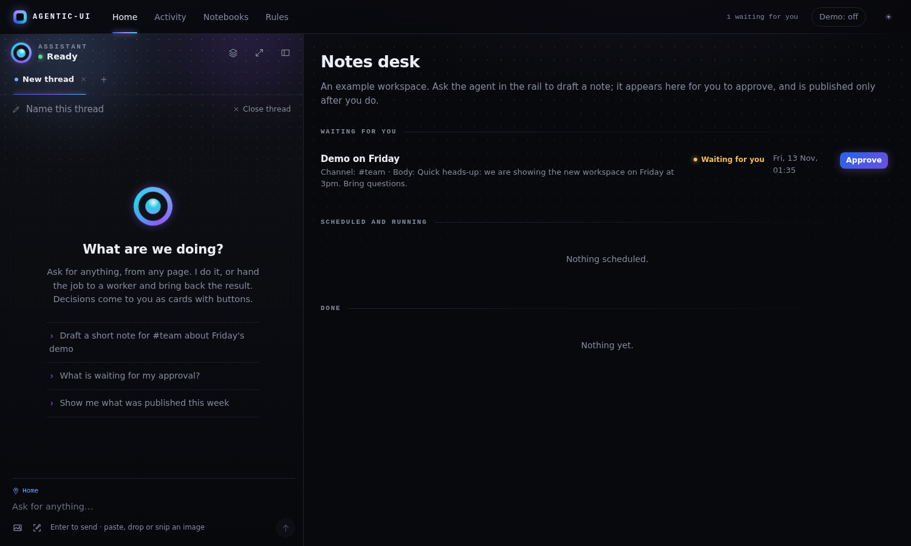

# agentic-ui

**Put agents inside your app.** A chat rail beside every page, workers that take jobs in the background, decisions that come to you as cards with buttons, and actions that only run after a human signs them off, checked character for character.

Built by Max Whitehead.



Most agent tooling is either a chat box bolted onto the side of an app, or an agent that acts with no one watching. agentic-ui is the layer between: the agent works *inside* your app, sees which page you are on, does the work itself or hands it to a worker, and brings anything with consequences back to you as a card. The rule that matters is enforced in code, not in a prompt: an agent can propose an action, but only your click approves it, and the gate refuses the outgoing call if a single character differs from what you approved.

- **The rail** (`ui/chat.jsx`): threads, live streaming of text, thinking and tool calls, image attach/paste/drop, and a snip tool that freezes the page so you can draw round what you mean. Built on [`useChat`](https://ai-sdk.dev/docs/reference/ai-sdk-ui/use-chat) from the Vercel AI SDK.
- **Workers**: the main agent hands jobs to them (`ask_agent`) and waits for the result. You can read every worker's log in the rail.
- **Cards and panels**: the agent puts live records in front of you. The text on a card is drawn from the database, never from the agent, and its buttons call the app directly.
- **Gated actions** (`src/gates.js`): propose → approve → run in a time slot → the executor's one call is checked against what you approved: exact match, time window, rate limit, blocklist, one shot.
- **A policy hook on every tool call** (`mcp/hook.js`, `src/policy.js`): each agent can only use the tools its entry lists. If the app is down, the answer is no.
- **Activity log and notebooks**: every proposal, approval, gate decision, blocked call, shell command and file change is logged; agents keep notes that carry between conversations.
- **Demo mode**: one toggle switches to separate data and mock versions of every outside service, so you can film or show the app without real data and without anything leaving the machine.

Agents run through the [Claude Code](https://docs.claude.com/en/docs/claude-code/overview) CLI on **your own Claude login**. The launcher is one small file (`src/adapters/claude-code.js`), so another provider can be swapped in.

## Quickstart (5 minutes)

You need Node 20+ and Claude Code installed and logged in (`claude` works in your terminal).

```bash
git clone https://github.com/Maxwh21/agentic-ui.git
cd agentic-ui
./start.sh            # installs, builds the rail, starts the app
```

Open http://127.0.0.1:4477. The example is a tiny **notes desk**:

1. Ask the assistant: *"Draft a short note for #team about Friday's demo."*
2. It hands the job to the **writer** worker, which proposes a `publish_note` action.
3. The note appears as a card in the chat and on the home page. Press **Approve**.
4. At its time slot the app starts the **publisher**, whose one call to the notes service passes the gate only if it matches what you approved. The note is written to `data/published-notes.jsonl` (or POSTed to `NOTES_WEBHOOK_URL` if you set one).

Flip **Demo** in the top bar to try it with mock services and separate data. `npm test` runs the gate and policy checks.

## Core ideas

| Piece | What it is | Where |
|---|---|---|
| Main agent | The one you talk to in the rail. Never waits for a worker slot. | `agents.config.js` → `main` |
| Workers | Agents the main agent (or the app) hands jobs to. Each keeps its own conversation and log. | `worker: true` |
| Executors | Agents the app starts only to carry out one approved action. | `executor: true` |
| App tools | The app's own tools, served over MCP, checked on every call. | `src/tools.js`, `tools` in the config |
| Services | Outside systems as MCP servers, each with an optional mock for demo mode. | `services` in the config |
| Gated actions | Proposed by an agent, approved by you, carried out by an executor, checked by the gate. | `actions` in the config, `src/gates.js` |
| Cards and panels | Live records the agent puts in front of you, with buttons that call the app. | `show_actions`, `show_panel` |
| Policy hook | Asks the app before every tool call; anything unlisted is refused. | `mcp/hook.js`, `src/policy.js` |

How a message flows: the rail sends your message (and which page you are on) to `/api/ui/chat` → the runner starts `claude -p` with the agent's prompt, tools, hook and MCP servers → Claude Code's stream-json events are translated into the AI SDK UI message stream (`src/uistream.js`) → `useChat` renders text, thinking and tool calls as they arrive. Every tool call first goes through the hook.

## How to build your own workspace

Almost everything happens in `agents.config.js`, plus a prompt file per agent.

### Add an agent

1. Write `prompts/researcher.md` (what it is for, how it should work).
2. Add it to `agents`:

```js
researcher: {
  label: 'Researcher', icon: 'search', worker: true, model: 'sonnet', prompt: 'prompts/researcher.md', memory: true,
  tools: ['WebSearch', 'WebFetch'],            // Claude Code tools it may use
  appTools: ['remember', 'forget', 'propose_action'],
},
```

3. Restart. The main agent's `ask_agent` tool now lists it, and its log shows up under Workers in the rail.

### Give an agent a tool

Either an **app tool** (runs inside the app, with access to the database):

```js
tools: {
  lookup_order: {
    description: 'Look up an order by id.',
    input: { order_id: { type: 'number' } }, required: ['order_id'],
    handler: (ctx, args, { db, fail }) => db.prepare('SELECT * FROM orders WHERE id=?').get(args.order_id) || fail('No such order.'),
  },
},
```

then add `'lookup_order'` to the agent's `appTools`. Or an **outside service** as an MCP server:

```js
services: {
  tickets: { command: 'node', args: ['services/tickets.js'], mock: { command: 'node', args: ['services/tickets.js', '--mock'] } },
},
```

and list the tools it may call by full name, e.g. `tools: ['mcp__tickets__create_ticket']`. Agents only ever see the servers in this file (`--strict-mcp-config`), never your personal connectors.

### Gate an action

Anything with consequences (sending, publishing, filing, merging) should be an action:

```js
actions: {
  file_ticket: {
    label: 'Ticket',
    fields: { project: 'Project', title: 'Title', body: 'Description' },
    executor: 'filer',                              // an agent with executor: true
    tool: 'mcp__tickets__create_ticket',            // the one call it may make
    match: { project: 'project', summary: 'title', description: 'body' }, // tool argument -> field, compared exactly
    window: { start: '09:00', end: '17:00', days: [1, 2, 3, 4, 5], timeZone: 'Europe/London' },
    rate: { perDay: 30, gapMinutes: 1 },
    blocklist: 'project',                            // values you can block on the Rules page
    outcome: (text) => (/"key"\s*:/.test(text) ? 'done' : 'failed'),
  },
},
```

Agents propose with `propose_action`, show it with `show_actions` (`ask_approval: true` adds the button), and you approve. The gate then refuses the executor's call unless: the action is approved, its slot has come, it is inside the window, under the rate limit, not blocklisted, the call is the first from this run, and every mapped argument matches what you approved (no extra arguments).

### Add a card type

Cards are React components in `ui/chat.jsx`. The pattern: an app tool whose result is just an acknowledgement (`show_actions` returns `{ shown: [...] }`), a case in `blockKind()` that recognises the tool call, and a component that loads the live records with `useLive()` and calls the app's API from its buttons. Copy `ActionsCard` as a starting point, then `npm run build`.

### Add a page

Pages are plain JavaScript in `public/app.js` (no build step). Add a function that renders into `#page`, a nav link in `public/index.html`, and a case in `page(hash)` in the config so the agent is told where you are and the rail offers the right starter prompts:

```js
page(hash) {
  if (hash.startsWith('#/orders')) return { label: 'Orders', line: 'You are on the orders page.', starters: ['Which orders are late?'] };
  ...
},
```

### Hand work to a worker

The main agent calls `ask_agent({ agent, message })` and waits (up to four minutes, then `agent_result` keeps waiting). The worker does not see the main conversation, so the message must carry everything it needs. The app can also start a worker itself with `runner.ask(agent, 'worker', 1, text, 'auto')`, e.g. when a record changes.

## The safety model, honestly

**Enforced in code:**
- Every tool call by every agent passes the policy hook. An agent can only use what its config entry lists. If the app is unreachable, everything is denied.
- Gated tools can only be called by an executor run for an approved action, and only with exactly the approved arguments, once, inside the window, under the rate limit, and not blocklisted. Approval requires the card's version to match the record, so a draft changed after you looked at it cannot be approved by that click.
- Agents only get the MCP servers listed in the config. Each run has its own secret token, valid only while it runs.
- In demo mode, outside services are replaced by their mocks, tools in `demo.blockTools` are refused, and file tools may not touch the real `data/` folder.
- The browser API only accepts writes from the local page (custom header plus a localhost host check).

**Instructions, not locks:**
- What an agent *says* and how well it follows its prompt. If you give an agent `Bash`, `Edit` or `Write`, it can do anything your user account can do inside its working folder; the hook logs every command and file change, but a shell is a shell. Give shell and file tools only to agents that need them.
- Demo mode's file guard matches paths in the tool's arguments; it is a safety net, not a sandbox.

The app listens on 127.0.0.1 only. It is a local tool, not a multi-user server.

## Project layout

```
agents.config.js          your agents, tools, services, actions, pages, demo settings
prompts/                  one file per agent, plus rules.md for all of them
server.js                 the app: internal endpoints for agents, API for the browser
src/
  runner.js               queue, sessions, parallel limit, worker hand-off
  adapters/claude-code.js how an agent is started (swap for another provider)
  policy.js               allow or deny each tool call
  gates.js                gated actions: propose, approve, schedule, check
  tools.js                the app's own tools (memory, hand-off, cards, panel, actions)
  uistream.js             Claude Code events -> AI SDK UI message stream
  db.js, mode.js, config.js
mcp/
  hook.js                 PreToolUse hook: asks the app
  app-mcp.js              the app's tools as an MCP server
ui/chat.jsx, chat.css     the agent rail (React + useChat), built into public/chat.bundle.*
public/                   the example host app (plain JS)
examples/notes-service.js the example's outside service, with --mock
test/                     gate and policy tests
```

## Roadmap

- Adapters for other providers (the Claude Agent SDK, the Anthropic API directly, OpenAI-compatible APIs).
- Support for the [AG-UI protocol](https://docs.ag-ui.com) alongside the AI SDK stream format.
- A cleaner way to register card components without editing `chat.jsx`.
- Per-action approvers (more than one person signing off).

## Licence

MIT. See [LICENSE](LICENSE).
